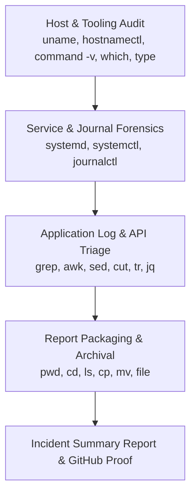

# Project Blueprint: **OpsPulse — Linux Service & Log Incident Triage Toolkit**

This self-contained project runs directly inside your **Killercoda Ubuntu 24.04 (`root@ubuntu`)** environment and combines all **21 commands** from your list into a real-world SRE/DevOps troubleshooting workflow.

---

## 1. Why You Are Building This & How It Helps DevOps Teams Daily

* **Why you are doing it:** Hiring managers and engineering leads don't want to see a list of commands on a resume—they want proof that you can diagnose a broken Linux host under pressure, automate repetitive triage, and leave clean documentation behind.
* **How it helps a DevOps/SRE team day-to-day:**
  1. **Cuts Mean Time to Resolution (MTTR):** During an incident, engineers waste 10–15 minutes manually checking if a service crashed, digging through messy logs, and verifying API health payloads. This script automates that entire first-5-minute triage into one clean summary.
  2. **Eliminates `$PATH` & Binary Guesswork:** In CI/CD runners and production VMs, mismatched tool versions or corrupted config files break deployments silently (`type`, `which`, `command -v`, `file`).
  3. **Standardizes Incident Handover:** Every run archives a timestamped report (`cp`, `mv`) so L1/L2 support engineers can attach clean evidence to Jira or PagerDuty tickets instead of pasting raw terminal dumps.

---

## 2. Project Architecture & Command Coverage



| Command Group | Exact Role in **OpsPulse** |
| :--- | :--- |
| `pwd`, `cd`, `ls`, `cp`, `mv`, `file` | Navigates the workspace, backs up configs before patching, verifies file types (`ASCII text` vs `JSON`), and archives incident reports. |
| `type`, `which`, `command -v`, `uname`, `hostnamectl` | Audits binary paths to prevent `$PATH` shadowing and captures OS/kernel metadata for the incident header. |
| `systemd`, `systemctl`, `journalctl` | Runs a simulated payment-worker `systemd` service, detects its crash/degraded state, and extracts recent failure logs from the journal. |
| `grep`, `awk`, `sed`, `cut`, `tr`, `jq` | Filters `502/500` errors, masks sensitive tokens, counts errors per IP/endpoint, normalizes case, and parses upstream JSON health responses. |

---

## 3. Complete Step-by-Step Implementation (Killercoda Ready)

### Step 1: Install `jq` & Create the Workspace
Your Killercoda Ubuntu 24.04 instance already has `systemd` and all standard GNU utilities. Install `jq` and build the project folder structure:

```bash
apt-get update -qq && apt-get install -y -qq jq
mkdir -p /root/opspulse/{bin,config,logs,api,reports,archive}
cd /root/opspulse && pwd
```

### Step 2: Generate Realistic Production Logs, Configs & JSON Payloads
Create a broken worker configuration, a simulated Nginx/App log with errors and exposed tokens, and an upstream Kubernetes/API health JSON response:

```bash
cat << 'EOF' > /root/opspulse/config/worker.conf
WORKER_ENV=production
MAX_RETRIES=3
UPSTREAM_URL=[http://10.24.18.9:8080/health](http://10.24.18.9:8080/health)
API_TOKEN=sk_live_98234aBcDeF7712
EOF

cat << 'EOF' > /root/opspulse/logs/app-gateway.log
2026-11-23T14:01:10Z|10.0.1.14|POST /api/v1/pay|200|42ms|token=sk_live_98234aBcDeF7712
2026-11-23T14:01:15Z|10.0.1.22|POST /api/v1/pay|502|3001ms|upstream_timeout
2026-11-23T14:01:19Z|10.0.1.22|POST /api/v1/pay|502|3004ms|upstream_timeout
2026-11-23T14:01:25Z|10.0.1.89|GET /api/v1/status|500|120ms|db_conn_refused
2026-11-23T14:01:31Z|10.0.1.22|POST /api/v1/pay|502|3002ms|upstream_timeout
2026-11-23T14:01:40Z|10.0.1.14|GET /api/v1/orders|200|18ms|ok
EOF

cat << 'EOF' > /root/opspulse/api/cluster-health.json
{
  "cluster": "prod-blr-01",
  "timestamp": "2026-11-23T14:02:00Z",
  "services": [
    {"name": "auth-api", "status": "healthy", "restarts": 0, "latency_ms": 21},
    {"name": "payment-worker", "status": "degraded", "restarts": 7, "latency_ms": 2980},
    {"name": "ledger-sync", "status": "healthy", "restarts": 1, "latency_ms": 45}
  ]
}
EOF
```

### Step 3: Create & Trigger a Failing `systemd` Unit
Create a real `systemd` service (`opspulse-worker.service`) that fails intentionally so you can diagnose it with `systemctl` and `journalctl`:

```bash
cat << 'EOF' > /etc/systemd/system/opspulse-worker.service
[Unit]
Description=OpsPulse Simulated Payment Worker
After=network.target

[Service]
Type=simple
ExecStart=/bin/bash -c 'echo "Starting payment-worker..."; echo "ERROR: Upstream 10.24.18.9 unreachable" >&2; exit 1'
Restart=on-failure
RestartSec=2

[Install]
WantedBy=multi-user.target
EOF

systemctl daemon-reload
systemctl start opspulse-worker.service
sleep 3
systemctl status opspulse-worker.service --no-pager || true
```

### Step 4: Create the Automated Triage Script (`/root/opspulse/bin/opspulse-triage.sh`)
This script executes all 21 commands together to produce an executive incident report:

```bash
cat << 'EOF' > /root/opspulse/bin/opspulse-triage.sh
#!/usr/bin/env bash
set -euo pipefail

BASE_DIR="/root/opspulse"
cd "$BASE_DIR"
TS=$(date +%Y%m%d_%H%M%S)
REPORT="$BASE_DIR/reports/incident_report_${TS}.txt"

{
  echo "=========================================================="
  echo " OPSPULSE INCIDENT TRIAGE REPORT | $TS"
  echo "=========================================================="
  echo "Working Directory : $(pwd)"
  echo "Kernel Info       : $(uname -srm)"
  echo ""
  echo "--- 1. HOST IDENTITY (hostnamectl) ---"
  hostnamectl | grep -E "Static hostname|Operating System|Kernel|Architecture" || true

  echo ""
  echo "--- 2. TOOLCHAIN & PATH VERIFICATION (command -v, which, type) ---"
  for tool in jq awk sed grep systemctl; do
    echo "Tool: $tool | command -v: $(command -v $tool) | which: $(which $tool) | type: $(type -t $tool)"
  done

  echo ""
  echo "--- 3. ARTIFACT INTEGRITY & CONFIG BACKUP (cp, file, ls) ---"
  cp "$BASE_DIR/config/worker.conf" "$BASE_DIR/config/worker.conf.bak"
  file "$BASE_DIR/config/worker.conf" "$BASE_DIR/api/cluster-health.json"
  ls -lh "$BASE_DIR/config/"

  echo ""
  echo "--- 4. SYSTEMD SERVICE & JOURNAL FORENSICS (systemctl, journalctl) ---"
  echo "Service Active State : $(systemctl is-active opspulse-worker.service || true)"
  echo "Service Failed State : $(systemctl is-failed opspulse-worker.service || true)"
  echo "Recent Journal Logs  :"
  journalctl -u opspulse-worker.service -n 6 --no-pager

  echo ""
  echo "--- 5. LOG ERROR ANALYSIS & TOKEN SANITIZATION (grep, cut, tr, sed, awk) ---"
  echo "Total HTTP 5xx Errors: $(grep -E '\|50[0-9]\|' "$BASE_DIR/logs/app-gateway.log" | wc -l)"
  echo "Top Offending Client IPs (cut + awk):"
  grep -E '\|50[0-9]\|' "$BASE_DIR/logs/app-gateway.log" | cut -d'|' -f2 | awk '{count[$1]++} END {for (ip in count) print "  " ip " -> " count[ip] " failures"}'
  echo "Sanitized Error Lines (sed masking secrets + tr uppercase severity):"
  grep -E '\|50[0-9]\|' "$BASE_DIR/logs/app-gateway.log" \
    | sed -E 's/sk_live_[A-Za-z0-9]+/[REDACTED_TOKEN]/g' \
    | tr 'a-z' 'A-Z'

  echo ""
  echo "--- 6. KUBERNETES / API JSON HEALTH TRIAGE (jq) ---"
  jq -r '.services[] | select(.status != "healthy") | "ALERT: Service \(.name) is \(.status | ascii_upcase) (Restarts: \(.restarts), Latency: \(.latency_ms)ms)"' "$BASE_DIR/api/cluster-health.json"

} | tee "$REPORT"

# Archive a copy for post-mortem retention (mv)
cp "$REPORT" "$BASE_DIR/archive/"
mv "$BASE_DIR/config/worker.conf.bak" "$BASE_DIR/archive/worker.conf.${TS}.bak"
echo ""
echo "[OK] Report archived to: $BASE_DIR/archive/incident_report_${TS}.txt"
EOF

chmod +x /root/opspulse/bin/opspulse-triage.sh
/root/opspulse/bin/opspulse-triage.sh
```

### Step 5: Clean Up the Simulated Service After Capturing Screenshots
Once you capture your screenshots, stop the failing test unit cleanly:

```bash
systemctl stop opspulse-worker.service && systemctl disable opspulse-worker.service
```

---

## 4. Exact Screenshots to Capture for LinkedIn & GitHub

Capture **4 crisp terminal screenshots** (use dark theme, zoom in once so text is readable on mobile feeds):

1. **`01-project-structure-and-systemd.png`**: Show `ls -lh /root/opspulse` and `systemctl status opspulse-worker.service` showing the `failed` / `activating (auto-restart)` service state.
2. **`02-triage-execution-output.png`**: Show the first half of `/root/opspulse/bin/opspulse-triage.sh` output (`hostnamectl`, `command -v`/`which`/`type`, `file`, and `journalctl` output).
3. **`03-log-and-jq-analytics.png`**: Show the second half of the report (`awk` IP failure aggregation, `sed` secret redaction, and `jq` JSON alert extraction).
4. **`04-github-repo-readme.png`**: Show your clean GitHub repository (`opspulse-linux-triage`) with the architecture diagram, script folder, and sample report committed.

---

## 5. How to Structure Your GitHub Repository (`opspulse-linux-triage`)

Push these exact files from Killercoda (or copy-paste them into a new public GitHub repo):

```text
opspulse-linux-triage/
├── README.md                  # Problem statement, Mermaid diagram, sample output & setup steps
├── bin/
│   └── opspulse-triage.sh     # The automated bash triage script
├── sample-data/
│   ├── worker.conf            # Simulated service configuration
│   ├── app-gateway.log        # Simulated HTTP 500/502 gateway log
│   └── cluster-health.json    # Simulated API/Kubernetes health JSON
├── sample-output/
│   └── incident_report.txt    # Real terminal output captured from Killercoda
└── screenshots/               # Your 4 terminal screenshots
```

---

## 6. Ready-to-Paste LinkedIn Post

Copy, paste, and replace `<YOUR-GITHUB-REPO-URL>` with your repository link, then attach your **3–4 terminal screenshots** as a multi-image carousel post:

```text
Most Linux learners memorize 50 isolated commands.
In real production incidents, nobody asks you what `awk` or `journalctl` stands for—they ask: "Why is the payment worker failing, which IPs are hitting 502s, and is the upstream API degraded?"

Over the past week, I built **OpsPulse**—an automated Linux Service & Log Incident Triage CLI tested end-to-end in an Ubuntu 24.04 lab environment—to put 21 core Linux commands to work on a realistic SRE scenario.

What OpsPulse automates during the first 60 seconds of an incident:
1. Host & Toolchain Verification: Audits OS/kernel baselines (`uname`, `hostnamectl`) and prevents `$PATH` binary shadowing (`command -v`, `which`, `type`).
2. Service & Journal Forensics: Inspects failing `systemd` units and pulls targeted crash logs via `systemctl` and `journalctl`.
3. Log Triage & Secret Masking: Filters HTTP 5xx spikes, aggregates top failing client IPs, normalizes log severity, and redacts leaked API tokens on the fly (`grep`, `cut`, `awk`, `sed`, `tr`).
4. API / Cluster Health Parsing: Extracts degraded services, restart counts, and latency spikes from structured JSON payloads (`jq`).
5. Safe Backup & Evidence Archival: Verifies file types before touching configs and archives timestamped incident reports (`pwd`, `cd`, `ls`, `cp`, `mv`, `file`).

Why this matters in day-to-day DevOps & SRE work:
- Cuts repetitive manual triage during on-call alerts
- Standardizes incident handover reports for engineering teams
- Prevents accidental edits on unverified config files

Full Bash script, sample datasets, and real terminal outputs are documented on GitHub:
🔗 <YOUR-GITHUB-REPO-URL>

What is the very first Linux command you run when an application service suddenly goes down in production? 👇

#Linux #DevOps #SRE #PlatformEngineering #LinuxAdministration #SystemAdministration #BashScripting #Troubleshooting #CloudEngineering #LearnInPublic #GitHub #InfrastructureAsCode #Observability
```
